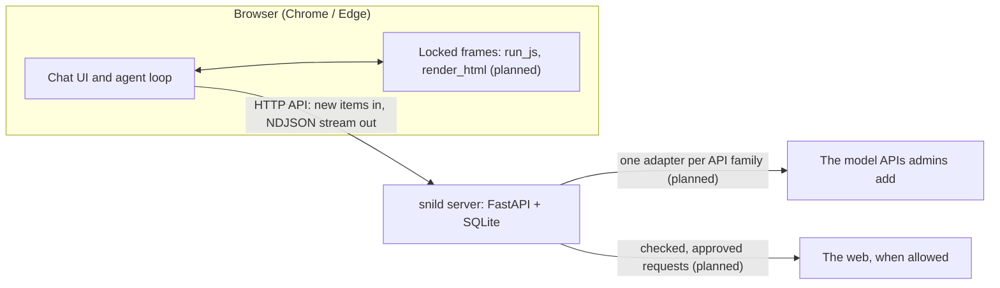

# Architecture

**snild** is a self-hosted AI assistant in the browser. Admins add the models it uses; snild never chooses one. Today it signs people in and holds streamed, saved chats with a built-in scripted test model. Connections to model APIs, files, analysis, reports and web access are planned; the sections below say which parts exist and which are planned.

**Core principle: the server decides, the browser works.** The server signs people in, stores chats (and, when planned work lands, files), talks to the models and decides what is allowed. The browser will run the agent's tools in locked frames. Nothing a model writes ever runs on the server.

## How a chat works

1. The browser posts only what is new: a user message, or the results of the tools it ran. The server owns the transcript, saves the new items and starts a **run**.
2. The run belongs to the server, not to the request. It streams events (text, reasoning, tool calls, the chat title) to every tab that follows it. Closing a tab does not stop it; only Stop does.
3. The server saves the model's step **before** it announces any tool call from it. The browser only ever runs tool calls the server has saved and checked against the tool contract (`snild/tools.json`).
4. The browser runs the tools, posts their results, and the loop repeats until the model answers.
5. Every turn carries the chat's revision and a request key. A retry with the same key replays the same run, so nothing runs twice; a stale tab gets a clear conflict instead of overwriting newer work.
6. On a new chat, its first words become the title at once. In the background a model (the configured title model, or the chat's own) writes a proper title. It never delays the reply and never overwrites a title the user set.

Today the scripted test model answers and no tool is enabled yet; the protocol for model calls and tool results is in place and tested. The exact contract, with every endpoint, event and error, is in [docs/protocol.md](docs/protocol.md).

## Server

One Python service (FastAPI, Uvicorn) and one SQLite file.

- **Models** *(planned)*. Admins add models in `config/snild.toml`. Each names the *provider* adapter for its API family: OpenAI-compatible APIs (OpenAI, Azure OpenAI, vLLM, Ollama and others) or Anthropic. The adapter owns authentication, payload shape, streaming and any opaque state a provider needs back unchanged; that state never leaves the server. The browser never knows which API answers.
- **The test model.** A scripted adapter that plays scenarios (`snild/scenarios/`): streamed text, reasoning, tool calls, broken arguments, provider errors, slow replies. It drives development and every end-to-end test without a key. It exists only when `SNILD_ENABLE_EMULATOR=1`, and the page then says so.
- **Passive storage** *(files planned)*. Chats, and later files, follow the user across devices. The server will never open, parse or run uploaded files; downloads will always be sent as attachments with `nosniff`.
- **Sign-in.** Accounts live in the same SQLite file: scrypt password hashes, sessions stored only as SHA-256 of an HttpOnly, SameSite=Lax cookie (7 days unused, 30 at most). The first admin is created in the browser with a one-time code from the log. Admins add everyone else in the browser (account menu, People) and set their first password; people change it themselves. There is always an enabled admin; `snild-admin` is the way back in when no admin can sign in.
- **Organisation sign-in** *(planned)*. snild has either a handful of local accounts or OIDC. With OIDC, the internal user id still owns chats and roles; an identity maps by issuer and subject, never to a local account by matching email.
- **Accepted hosts.** The compose file publishes the port on loopback unless `SNILD_BIND` says otherwise. Separately, snild checks the `Host` header: without `public_url` it accepts `localhost` and literal loopback or private IP addresses; with `public_url` it accepts only that host and port (and loopback on `/health`).
- **Logging.** Metadata only (who, when, which model, tokens, status), never chat text.

## Browser

No framework and no build step: native ES modules with JSDoc types and plain CSS, served exactly as they are in the repo.

| Folder | Holds |
|:--|:--|
| `web/js/core/` | No DOM: the protocol, a chat's state, the agent loop, the Markdown parser, the chat list's dates. Tested in Node. |
| `web/js/runtime/` | The API client (the only code that talks to the server), the conversation that keeps a chat in step with the server, tab sync, addresses, drafts; later the frame host and the tools. |
| `web/js/ui/` | Thin views on semantic HTML, the Markdown renderer, all interface text in one module. |

## Tools *(planned)*

The model will get three tools and a short instruction built around JavaScript, SQL and HTML it already knows. The contract is in `snild/tools.json`; every tool is switched off until it exists.

- **`run_js(code)`** runs ordinary JavaScript (with `await`) in a fresh worker inside a locked frame: `fs.readFile()` for the chat's files, `sql()` for DuckDB over CSV, Excel and Parquet, `d3`, and a small virtual `document` so ordinary d3 code returns finished SVG or HTML. The model gets back the `return` value, its `console.log` output and clear errors. A time limit is enforced from outside the worker.
- **`render_html(html)`** shows the user a page the model wrote, a whole page or a fragment, in the report panel. The model gets back errors and a short summary of what appeared, so it can check its own work.
- **`fetch_url(url)`** is offered only when the chat has the web switched on. The server checks and makes the request; the browser turns the answer into readable text in a locked frame.

The libraries the tools need (DuckDB-WASM, d3) will be served by snild itself, pinned by version and SHA-256.

## Security boundaries

**The trusted page.** A strict Content-Security-Policy: scripts only from snild, no inline script, no eval, no plugins, never framed. Model text is rendered as Markdown by snild's own renderer, which builds DOM nodes and never parses HTML; links are limited to web and mailto addresses; remote images never load. Every state-changing request must carry snild's exact `Origin`.

**Locked tool frames** *(planned)*. Each tool runs in `<iframe sandbox="allow-scripts">` with no origin of its own, so model code cannot read cookies or call snild's API. A strict CSP blocks network requests from the frame. A runaway loop is stopped at its time limit, and a frame that crashes is replaced.

**Reports** *(planned)*. Every report load is authorised and never cached. By default a report is shown sanitised and without scripts. Scripts run only after snild has checked that the browser enforces the `Connection-Allowlist: ()` header, which blocks every network path including WebRTC and link prefetching (which CSP alone does not stop). Reports always sit inside snild's own frame and can never cover an approval prompt.

**Web access** *(planned)*. `fetch_url` is the agent's only way out, and it starts switched off. The server resolves names itself, refuses private and internal addresses unless the admin lists them, connects to the checked address, checks every redirect the same way, and caps size and time.

**Approval before anything leaves** *(planned)*. In a chat with files, every web request needs the user's approval: the dialog lists each exact request of a step, and the server binds the approval to that exact request. A redirect to another address needs a new approval.

## Testing

- `node --test` for the browser's core and views (views against linkedom).
- pytest for the server: the protocol, runs, storage, sign-in, headers. It runs in the test image.
- Browser tests in real Chrome and Edge, driven through the DevTools protocol with Node's own WebSocket (no packages): setup, sign-in, streaming, Stop, reload, dropped connections, a restart, two tabs, two people, keyboard use, over both a loopback and a non-loopback origin. Any console error or CSP violation fails a test.
- An image smoke test: the real container, the test model, a streamed and saved turn, and a stop in the middle of a reply.

## Roadmap

Implemented:

- The API contract, server-owned runs, storage, the scripted test model, the container image, CI.
- Accounts and sign-in, with people managed by admins in the browser; the chat interface with streaming, Stop, reload and model-written titles.

Planned:

- CSV and Excel analysis with `run_js`, reports with `render_html`, and containment tests for both.
- `fetch_url` with approval.
- Provider adapters: OpenAI-compatible and Anthropic.
- PDF and Word files; organisation sign-in (OIDC).
- Per-user API keys that the model only sees as placeholders; translations.
