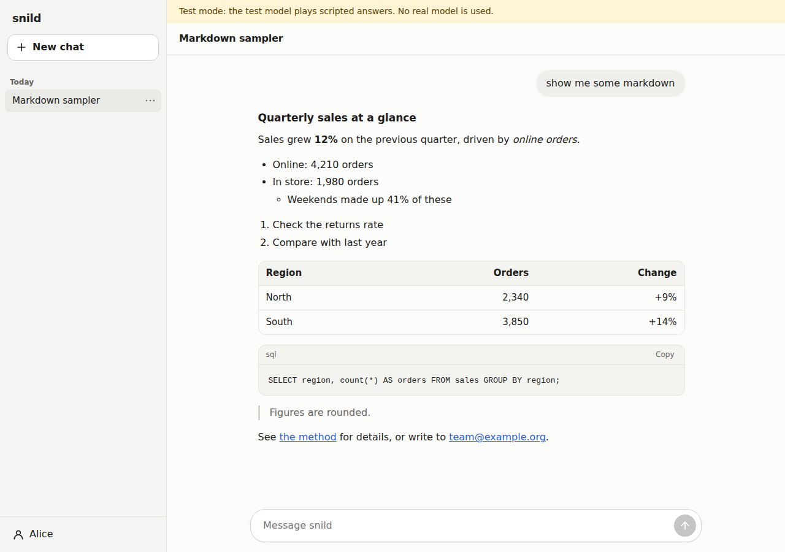

# snild

snild is a self-hosted AI chat that runs in the browser: one container, with everything it keeps (a SQLite file and the chats' files) in one data volume. This early preview has accounts that admins manage in the browser, streamed replies with Stop, chats that survive a reload, a restart or a second tab, model-written titles, files in chats (by upload, paste or drop, and files the model's code writes), and two tools: the model's JavaScript, with SQL over spreadsheets, PDFs read as HTML and d3 charts, runs sandboxed in the browser, never on the server; and reports, pages the model writes, which the browser shows in a sandboxed panel that runs no scripts and loads no external resources. All of it works with a built-in scripted test model. Planned: connections to the model APIs admins add, and OIDC sign-in as an alternative to local accounts. See [ARCHITECTURE.md](ARCHITECTURE.md).



## Quick start

You need Docker with Compose.

```bash
git clone https://github.com/jakobmwang/snild.git && cd snild
SNILD_ENABLE_EMULATOR=1 docker compose up -d --wait
docker compose logs snild
```

The log shows a one-time setup code. Open <http://localhost:8080>, enter the code and create your admin account. The setup code works for 30 minutes; until the first admin exists, restarting snild (`docker compose restart snild`) prints a new one.

Then ask the test model to *show me some markdown*: it streams a formatted sample answer, and the chat gets a title. Or ask it to *analyse the demo sales data*: it runs real code in your browser over two demo files (the same sales as CSV and Excel), checks one against the other and draws a chart. Or ask it to *check the demo sales report against the data*: it reads a PDF report of the same sales and finds the figure that is wrong. The report also hides a line of text, which snild keeps from the model: below the call you can show it and, if you like, add it to your message. Attach your own files with the paperclip (or paste or drop them): the model's code can read them and write new ones, and **Files** at the top of the chat lists them all for download. And ask it to *make a report of the demo sales*: it writes a report with a chart and a table, opens it in the report panel and saves it in **Files**.

## People

Admins open **Admin** in the account menu. Under **People** they add someone with a password to pass on, set a new password for someone who forgot theirs, disable or enable an account, and change someone's role; everyone can change their own password in the account menu. Under **Settings** they choose how long a sign-in lasts (by default 7 days unused, 30 days at most, or no limit), the largest file (25 MiB by default) and how much all of one person's files may hold (1000 MiB). Chats and files are kept until people delete them.

Everything snild keeps is in its data volume: the database and the chats' files beside it. Back up a stopped snild, or an atomic snapshot of the whole volume.

If no admin can sign in any more, `docker compose exec snild snild-admin --help` shows the way back in.

## Settings

| Variable | What it does |
|:--|:--|
| `SNILD_ENABLE_EMULATOR` | `1` adds the scripted test model. |
| `SNILD_PUBLISH_PORT` | The host port snild is published on. Default `8080`. |
| `SNILD_BIND` | The host address the port is published on. Default `127.0.0.1`. |

Set them in the environment or in a `.env` file next to `compose.yaml`. What snild needs before it starts is described in `config/snild.toml.example` (copy it to `config/snild.toml` to use it); what admins may change while it runs is under **Admin**, **Settings** in the browser.

## Development

[CONTRIBUTING.md](CONTRIBUTING.md) has the tests and how to run them, [ARCHITECTURE.md](ARCHITECTURE.md) the design and roadmap, and [docs/protocol.md](docs/protocol.md) the browser–server protocol.

## Licence

snild is licensed under the [Apache License 2.0](LICENSE). The container image also includes the browser libraries listed in `vendor.json`, each under its own licence. One of them, digpdf, which reads PDFs, is not open source: it may be used for any purpose, including commercial use, and redistributed unmodified, provided its licence and third-party notices go with every copy. The image keeps both beside it (`web/vendor/digpdf/`).
